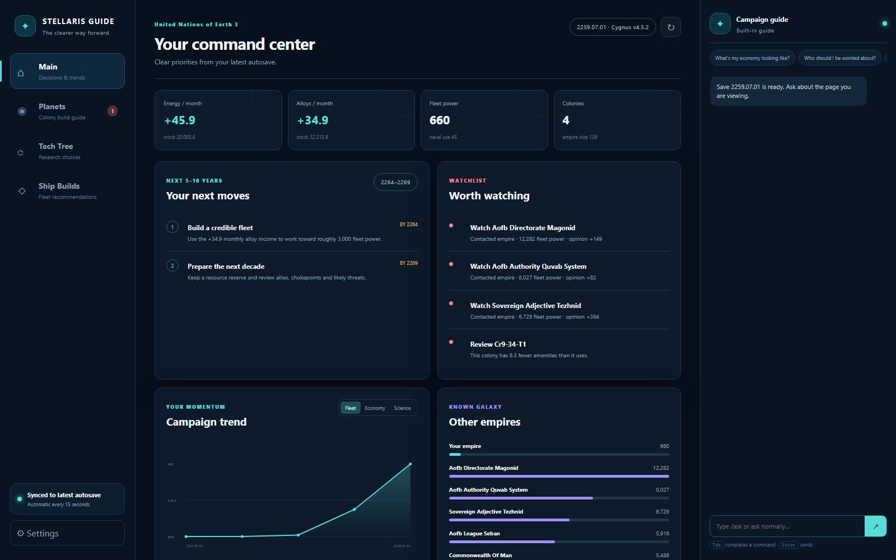

# Stellaris Guide

Stellaris Guide is a read-only Windows campaign companion for **Stellaris 4.5 Cygnus**. It watches the latest autosave, turns it into a short 5–10 year plan, explains colony problems, suggests research and ship building priorities, shows contacted empires' opinions, and answers campaign questions.



## Start here

- **Online Web Companion (zero install, saves stay in your browser):** https://microyoda.github.io/stellaris-guide/
- **Windows Desktop App (`.exe`):** Download `StellarisGuide-Windows-1.6.4.zip` or `StellarisGuide.exe` from [GitHub Releases](https://github.com/microyoda/stellaris-guide/releases/latest). Extract the zip and double-click `StellarisGuide.exe`; no mod, Node, terminal, or AI account is required. See the [nontechnical installation guide](docs/INSTALL.md).

## What's new in 1.6.4

Chat now answers named planet and empire questions with selected-save evidence and clearer uncertainty. Tech Tree cards show more possible downstream research and plain descriptions while keeping direct prerequisites exact. The Fleet Design Finder compares owned Corvette, Frigate and Destroyer designs for a chosen goal and player-observed opponent. It labels unverified buildability and unknown costs instead of claiming a guaranteed best build. See [v1.6.4 release notes](docs/RELEASE-1.6.4.md).

## What's new in 1.6.3

The next-move cards now show reviewed strategy playbook details for resource shortages and unstable colonies, with separate rule and strategy status, trade-offs, and change-course checks. See [v1.6.3 release notes](docs/RELEASE-1.6.3.md).

## What's new in 1.6.1

**Tech Tree** shows a clickable, illustrated path to a target technology in a separate Edge window. **Fleet** shows owned fleets, saved designs, recorded components and policies, with a build planner. Enter the naval limit shown in Stellaris once per campaign; the Guide saves it locally and flags planned builds over that limit. Unknown costs, stats and incomplete save details are labelled. See [v1.6.1 release notes](docs/RELEASE-1.6.1.md).

The app checks the newest autosave every 15 seconds. Press **↻** whenever you want an immediate manual check. Saves are read only and are never changed.

## What's new in 1.6.0

The main page prioritizes save-grounded next moves, resource risk and a pinned goal. Planet advice checks job settings and resource runway. Research routes open in a separate, closable Edge window and mark unverified DLC or mod rules as limited. Chat cites selected-save evidence and checks numerical claims before showing optional AI answers. Spoiler consent applies to the exact selected save and turns off at the next autosave. See the [v1.6 release notes](docs/RELEASE-1.6.md) for verification and limitations.

## What's new in 1.5.2

The Watchlist now sits in a slim horizontal row below the campaign title and date. It advances automatically every seven seconds, including after you use the previous or next arrow.

See [v1.5.2 release notes](docs/RELEASE-1.5.2.md).

## What's new in 1.5.1

The Watchlist is a compact rotating ticker beside the campaign title. Main now has Military, Economy, Technology, and Opinion galaxy charts; the player appears at their actual rank when comparison values are available. Opinion is shown separately without strength ratios. Native Windows capture now reads Stellaris window pixels even when another window covers it.

If an older badge such as **v1.4.2** is showing, quit that tray app before opening the new executable. See [v1.5.1 release notes](docs/RELEASE-1.5.1.md).

## What's new in 1.5.0

Main has an expandable empire-health summary. Planets shows saved job settings and advice. The new Empires tab compares military, economy, technology, diplomacy, and intel with your empire pinned as reference. Exact hidden rival data requires a double-confirmed per-campaign spoiler setting. Ship Builds checks saved slots. The camera opens the Stellaris window directly when Windows can identify it.

See [v1.5 release notes](docs/RELEASE-1.5.md) for limits and verification.

## What's new in 1.4.3

The Campaign guide now has local question history with recent and often asked shortcuts. The camera button captures a screen or window, lets you crop a region, and sends only that selected image with your question to a vision-capable Ollama, LM Studio, or OpenRouter model. Screenshots are not saved in question history. If a model cannot analyze the image, the Guide says so instead of pretending it saw it.

## What's new in 1.4.2

The sidebar shows a version badge below the Stellaris Guide title, so you can quickly see which Windows build is running.

## What's new in 1.4.1

The **How to achieve this** steps on the Main page now start collapsed, making the graphs visible sooner. Open a goal's steps when you want the actions; an open goal stays open when the dashboard checks the next autosave.

## What's new in 1.4

Each **Your next moves** goal now has save-based steps directly below it and progress that persists across autosaves. The Planets tab names the colony to inspect, the Tech Tree tab shows a prerequisite path from installed game files, and Ship Builds shows selected military policies. Empire flags and selected game icons load from the local Stellaris installation when found. See [release notes](docs/RELEASE-1.4.md) for limits and verification.

## Dashboard pages

- **Main:** next moves, warnings, empire indicators, campaign trends, and contacted empire opinions.
- **Planets:** colony stability, pops, housing, amenities, designation, output hints, and a plain language build recommendation.
- **Empires:** your empire and contacted rivals across military, economy, technology, diplomacy, and intel; unknown values are labelled.
- **Tech Tree:** current research, visible alternatives, and one suggested next choice for each research branch.
- **Ship Builds:** owned combat designs, visible components, and a cautious reinforcement recommendation.
- **Campaign guide:** type `/ask`, press **Tab** to complete the command, or use the page-specific quick questions.

The four quick indicators are on Main; other pages use that space for their own details.

Closing the browser does not stop save monitoring. Use the **Stellaris Guide** icon in the Windows notification area to reopen the dashboard, refresh the latest save, or quit the application completely.

## Chat providers

The built-in guide works without an account or internet connection. Optional providers are Ollama, LM Studio, and OpenRouter. LM Studio requests may run for up to five minutes so slower local models do not fail at the previous 45 second limit. If an AI provider fails on a text question, the app returns a built-in answer and displays the provider error. For a screenshot question, it says the image was not analyzed and keeps the attachment for retry.

## Compatibility

The parser and UI data contract were tested against **Cygnus v4.5.2** Windows autosaves, including a 2277.10.01 campaign with eight readable colonies and twelve contacted empires, plus synthetic regression saves. They yielded research queues, owned ship designs, resource balances, jobs, and contact data. Some foreign strengths remain unknown without spoiler mode.

Stellaris remains the source of truth for exact costs, prerequisites, combat counters, hidden intelligence, allies, positioning, and modded mechanics. Recheck compatibility after major game updates.

## Project documents

- [Installation guide](docs/INSTALL.md)
- [Product plan and growth roadmap](docs/PRODUCT.md)
- [Technical guide and extension workflow](docs/TECHNICAL.md)
- [System architecture and future boundaries](docs/SYSTEM-ARCHITECTURE.md)
- [Proposed v1.6 credibility release](docs/RELEASE-1.6-PLAN.md)
- [Claude review triage](docs/CLAUDE-REVIEW-TRIAGE.md)
- [Research on empire flags and technology artwork](docs/ARTWORK-RESEARCH.md)
- [Research on mapping the Stellaris tech tree](docs/TECH-TREE-RESEARCH.md)
- [Research on policy, diplomacy, and strategy advice](docs/STRATEGY-RESEARCH.md)
- [Stellaris 4.5 Cygnus strategy and release findings](docs/CYGNUS-4.5-STRATEGY.md)
- [Future Stellaris 4.6 Ideologies watchlist](docs/WILLPOWER-4.6-IDEOLOGIES.md)
- [Historical v1.5 planning record](docs/NEXT-RELEASE.md)
- [UI/UX rationale](docs/DESIGN.md)
- [Interactive design page](docs/design.html)

## Developer quick start

```powershell
python app.py
```

Run tests from the project root:

```powershell
python -m unittest discover -s tests -v
```

Build the Windows package:

```powershell
build_windows.bat
```

This is an independent fan project and is not affiliated with Paradox Interactive.
