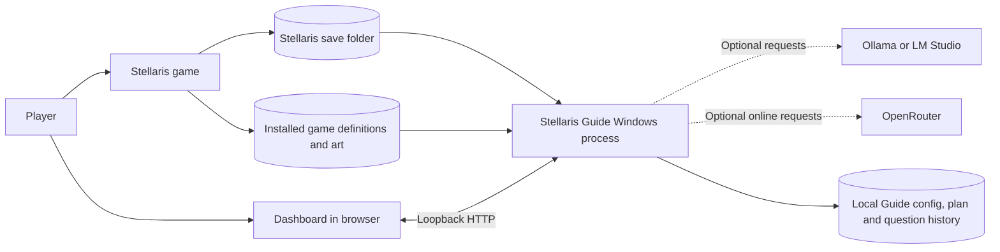
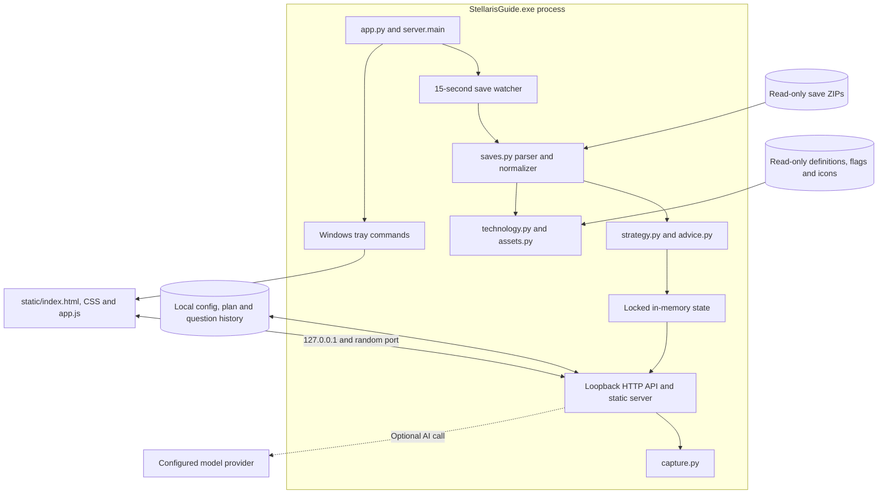
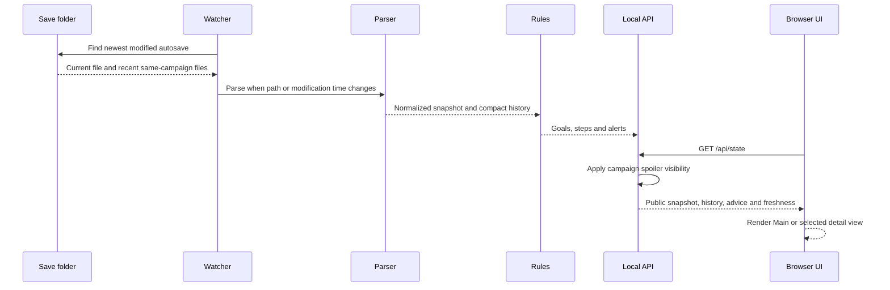
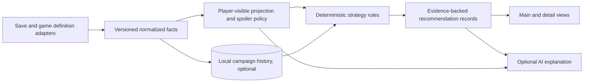

# Stellaris Guide — system architecture

**Baseline:** v1.5.2, October 18, 2026. The first diagrams describe the implemented application. The target architecture later in this document is a proposal for expansion, not a description of existing modules.

## System context

Stellaris Guide is a local, read-only companion. The Windows executable hosts the server, watcher, and tray icon; the default browser hosts the dashboard. Stellaris and its saves remain outside the application's control. AI providers are optional explanation services, while deterministic guidance runs locally.

The dashed AI paths are used only when the player chooses and configures a provider. OpenRouter is the online path; the other configured providers are local services. No provider is required for the core dashboard.

## Implemented runtime components

Startup loads config and plan, scans the current save, starts the watcher, opens the HTTP server on an available loopback port, starts the tray icon, and opens the browser. The browser and watcher independently poll every 15 seconds. The Watchlist changes its displayed alert every seven seconds while the tab is visible; this rotation does not trigger another save parse.

## Save-to-screen sequence

Selection uses filesystem modification time; it does not select the largest in-game date globally. Detailed planet, technology, and ship parsing is performed for the newest selected save. The previous selected saves support trends. A damaged save can produce a visible error state; it must not lead the UI to present stale data as freshly verified.

## Trust and data boundaries

| Boundary | Current rule | Expansion rule |
| --- | --- | --- |
| Game save → parser | ZIP `meta` and `gamestate` are untrusted input; parsing is defensive and does not write back. | Bound memory, validate new field shapes, and test malformed and version-shifted saves. |
| Raw snapshot → public API | `public_snapshot()` hides foreign exact values without campaign spoiler consent. | Every new endpoint, export, graph, and AI context must pass this boundary. |
| Browser → local server | Loopback binding, local Host check, random token on POST, bounded request and image size. | Preserve these guards for each route; do not make the server LAN-accessible casually. |
| Screenshot → provider | One-shot player capture and crop; image sent on question submission. | Show provider destination and never save or upload images in the background. |
| Local Guide → OpenRouter | Explicit online provider using a session-held key. | Keep core recommendations independent of availability and cost of external models. |
| Game definition/art folder → renderer | Read-only, optional, best-effort local assets. | Track enabled mod/DLC overrides before claiming an item is buildable. |

Spoiler mode is a *visibility boundary*, not a guarantee that every remaining contact value matches the in-game Contacts screen. Player-visible intel and exact saved values must be distinguished in the domain model before more rival advice is added.

## Current data contracts

- **Snapshot:** plain Python dictionary with campaign path, file modification time, game date/version, player resources and capacity, contacts, policies and flag. The newest snapshot also contains planets, technology and ship builds.
- **History:** up to six parsed same-campaign saves. Historic detailed collections are intentionally omitted.
- **Advice:** up to five goals and four Watchlist alerts. Goals have title, detail, due date, progress-related values and steps; alerts have title and detail.
- **Public state:** status, public snapshot/history, advice, error and update time, plus public config, token, poll interval and app version.
- **Chat context:** a compact subset of the *public* snapshot and goals, selected according to the active tab. The model is asked to use the supplied facts and to identify uncertainty.

These contracts are implicit dictionaries in v1.5.2. Consumers should treat optional fields as absent rather than zero. The product's proposed recommendation contract appears in [PRODUCT.md](PRODUCT.md).

## Proposed architecture for growth

Add boundaries gradually around the current code, keeping the executable and local API working throughout migration:

1. **Versioned adapters.** Detect save version and map it into one documented fact model. Keep version-specific parsing and enabled mod definitions behind adapters. A new game's patch should fail safely as Unknown until validated.
2. **Fact provenance.** For each decision-relevant fact, carry source save date, path or parser source, unit, visibility class, and confidence/validation state. This prevents a saved internal score from silently becoming a player-visible rating.
3. **Single visibility projection.** Filter facts before any API, graph, export, history view, or AI prompt. Test the boundary with low-intel and spoiler-on/off fixtures.
4. **Recommendation records.** Let rules produce observation, proposed action, expected effect, trade-off, checks, confidence, and expiry. The UI and AI should explain the same record; AI should not invent a new build eligibility decision.
5. **Campaign history.** If six saves are insufficient for long-term planning, add a small local history store with explicit retention, schema migration, and campaign isolation. This is optional; it is not a database in the current release.
6. **Small UI modules.** If `static/app.js` becomes hard to maintain, split state fetching, charts, tabs, chat, and capture at stable API boundaries. Preserve the one-screen Main experience and accessible keyboard behavior.

## Change impact map

| Proposed feature | Main changes | Proof needed before release |
| --- | --- | --- |
| Planet build eligibility | Save adapter, installed definitions, planet rule, Planets card and chat context. | Same-date colony screen, available slot/capacity, resource cost and upkeep, missing-mod case. |
| Ship design suggestion | Slot-by-slot ship parser, component eligibility and fleet rule, Ship Builds view. | Match in-game designer sections, repeated components, stats, costs and unlocked alternatives. |
| Rival diplomacy/espionage | Contact parser, visibility projection, Empires view and threat rules. | Player-visible intel level, treaty/war side, subject ties, spoiler isolation. |
| Future game version | Version detector and adapter, fixture corpus, compatibility text. | Regression suite on old and new versions; no silent reinterpretation of a field. |
| Optional scenario planning | Validated cost model and explicit assumptions, separate UI entry point. | Scenario result labelled hypothetical, with ranges and resource trade-offs. |

## Architectural decisions to preserve

- Keep core use local, portable, read-only, and functional without a model provider.
- Treat the save as evidence of the last saved state, not as a live game API.
- Keep the spoiler gate on the server. A UI-only switch cannot protect API or AI responses.
- Use deterministic calculations for recommendations; use AI for explanation and question answering only where supported by known facts.
- Release compatibility claims only after same-date save and in-game checks across representative campaigns.

Implementation and test commands are in [TECHNICAL.md](TECHNICAL.md). Current feature behavior and proposed priorities are in [PRODUCT.md](PRODUCT.md).
